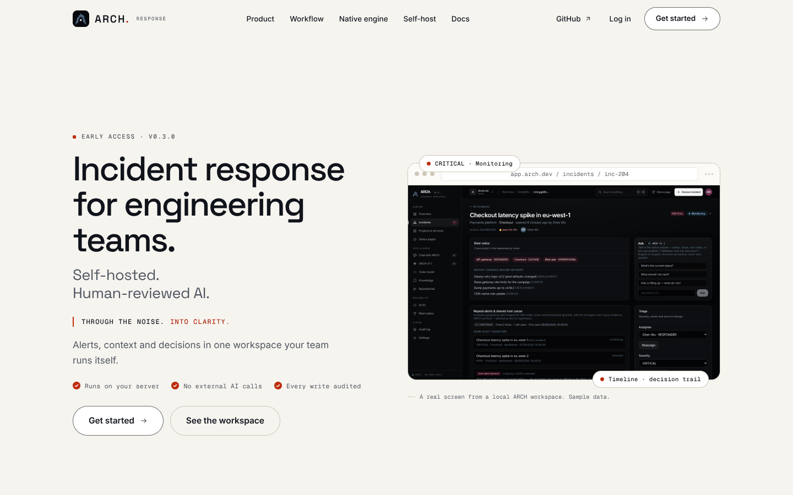
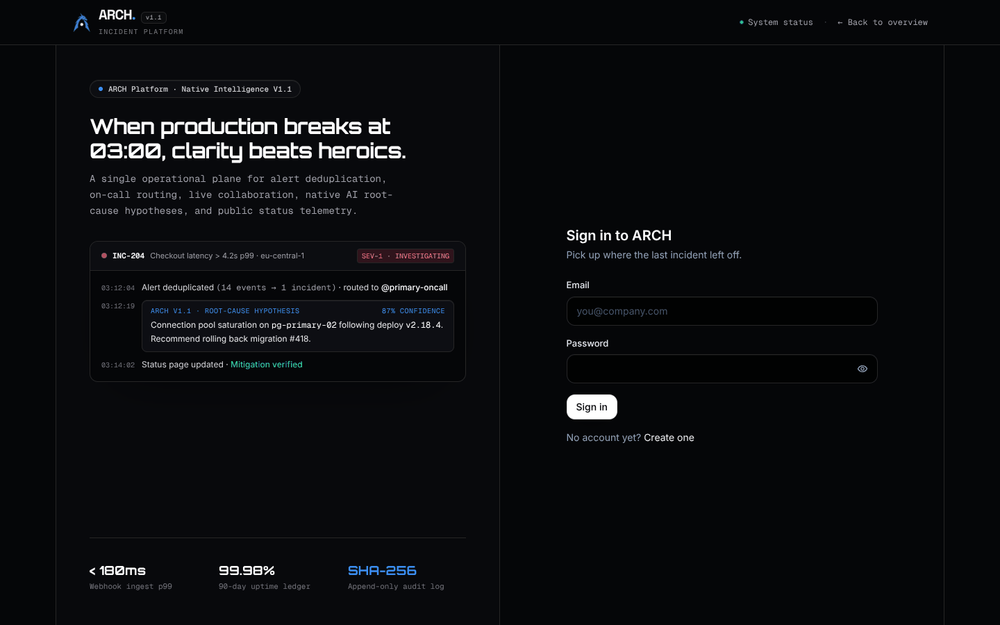
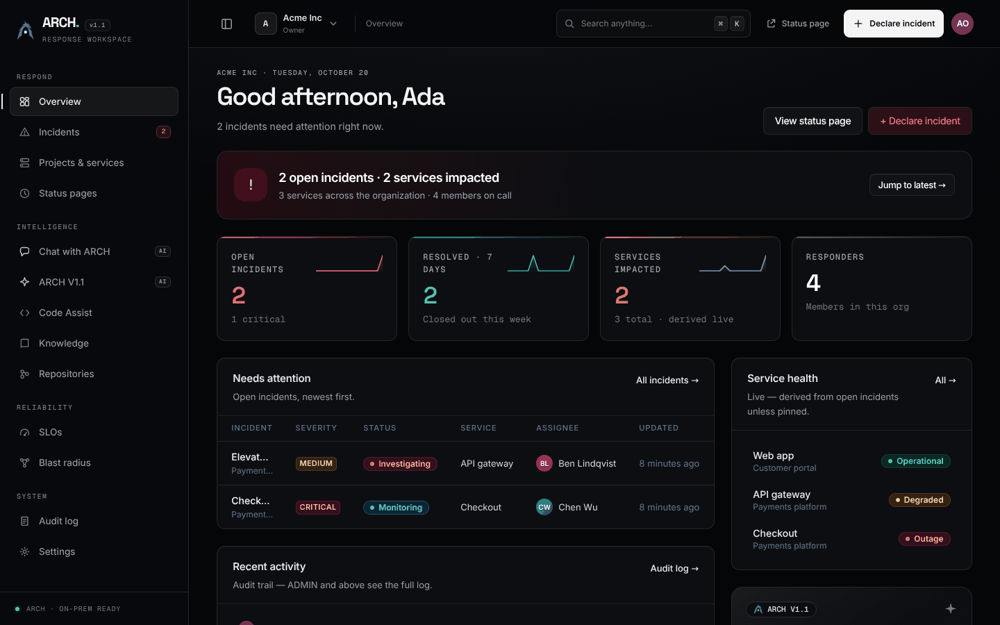
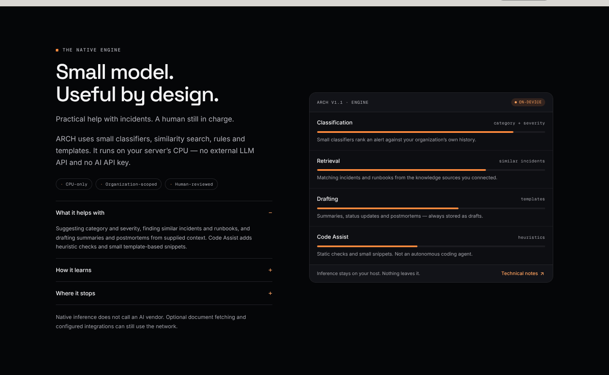
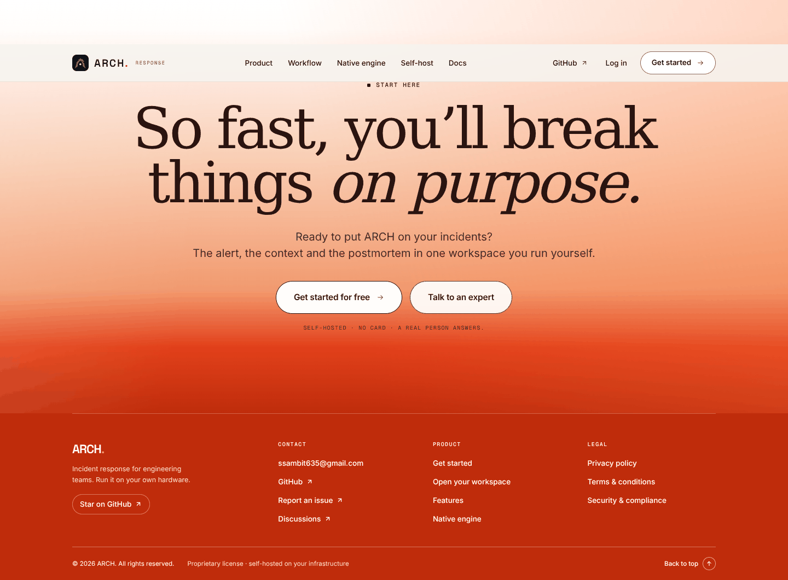
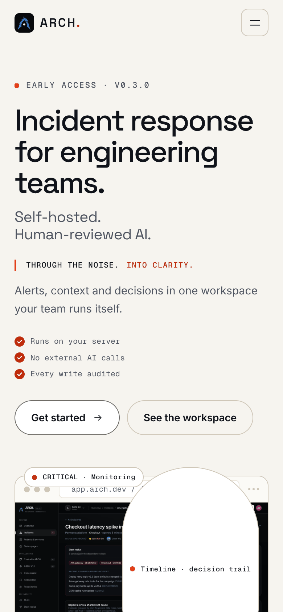
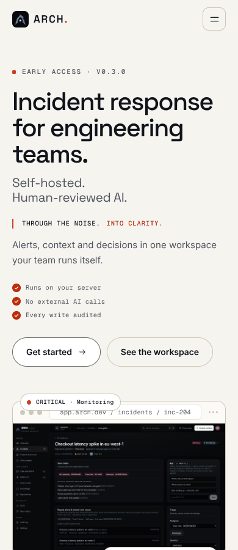

# ARCH landing page — design, product & API review

**Date:** 2026-10-20 · **Scope:** `src/app/(marketing)`, `src/components/marketing`, the app shell it hands off to, and the API surface behind the claims.
**Method:** read every marketing component and both stylesheets; ran the app against a real PostgreSQL; screenshotted at 390 / 430 / 768 / 1024 / 1440 / 1920 with a headless Chromium; measured layout, contrast, tap targets and network; ran `npm run typecheck`, `npm test` (671 tests) and `npm run smoke:api` (129 checks). Nothing below is assumed — every number in this document was measured on the running build.

---

## 0. The one-line verdict

> **The page is well-built but off-brief.** It is a carefully made *self-hosted product site* with a warm editorial voice. It is not yet a Stripe × incident.io hybrid, and it is not yet selling a SaaS — the copy and the primary CTA argue for the opposite business model.

---

## 1. Is it even a SaaS?

**Architecture: yes. Business: no. Landing page: it sells the opposite.**

| SaaS signal | Evidence in the repo | Verdict |
|---|---|---|
| Multi-tenant data model | `Organization` + `Membership` + 4 server-enforced roles; every repository is org-scoped; smoke test proves a foreign tenant gets a 404 | ✅ real |
| Per-tenant auth & invitations | `Invitation` model, single-use token links, owner/admin/responder/viewer | ✅ real |
| Usage-based identity | `ApiToken` with scopes, revocation, creator-role re-check on every call | ✅ real |
| Public customer surface | Published status pages (`/status/[slug]`), 90-day uptime, incident history | ✅ real |
| **Billing** | **Zero** references to Stripe, subscriptions, invoices, plans, quotas or limits in `src/` or `prisma/schema.prisma` | ❌ absent |
| **Plan enforcement** | None. `docs/product/PRICING.md` defines 5 plans and seat/service limits — it is a hypothesis doc ("Not yet validated with paying customers") | ❌ absent |
| **Pricing page** | No `/pricing` route, no price anywhere on the site | ❌ absent |
| **Trust surface** | No `/security`, `/legal`, `/docs`, `/changelog` on-site — all four are links into the GitHub repo | ❌ absent |
| **Measurement** | No analytics of any kind (grep for `gtag`, `plausible`, `posthog`, `vercel/analytics` → 0) | ❌ absent |

### The three contradictions that make the answer "not yet"

1. **"Self-hosted" vs. "Get started".**
   The hero's first promise is *self-hosted*, the deploy section is `git clone`, and the footer says *no card* — while both primary CTAs send visitors to `/register` on a hosted app. Two funnels, one page, no pricing between them.

2. **`LICENSE` says you may not run it.**
   `LICENSE` is *Proprietary — NO LICENSE GRANTED*, yet the page's call to action is "clone this repo and `npm run dev`". A visitor is being invited to install software they have no right to use. This is the single sharpest credibility problem on the site, and it cannot be fixed with design.

3. **The product's differentiator is buried.**
   The genuinely unusual thing here — *native inference on your own CPU, no LLM API key, human-approved drafts* — is real (see §6). But it appears as the **third** line of the H1, then four more times as disclaimers. The page hedges its own best feature until it sounds like an apology.

**What it actually is today:** a *self-hostable, multi-tenant incident-response product* with SaaS-grade internals and no commerce layer. That is a legitimate business — open-core, self-hosted + paid cloud — but the page has to pick one and commit.

---

## 2. What the design actually is (it is not 50/50)

The header comment in `landing.css` is honest about the current lineage:

```css
/* Geometry follows the HackerRank reference supplied with the brief … */
```

Measured against the two reference brands:

| Dimension | Stripe | incident.io | ARCH today |
|---|---|---|---|
| Canvas | White `#FFFFFF` / `#F6F9FC` | Light Sand `#F8F5F0` | **Paper `#F6F4EF`** ← incident.io |
| Accent | Blurple `#635BFF` | Alarmalade `#F25533` | **Ember `#E2401A`** ← incident.io |
| Ink | Navy `#0A2540`, slate body `#425466` | Charcoal `#161618` | **`#10131A` / `#4F5561`** ← incident.io |
| Type | Söhne (sans only) | Bureau Sans + **serif** for large headings + Geist Mono | Space Grotesk + Inter + mono; **serif only in the footer** ← half-borrowed |
| Controls | 6–8px radius, solid indigo fill | **9999px pill**, coral or outline | **9999px white pill + ink label** ← neither |
| Composition | Bento grid, gradient ribbon, code samples, logo wall | Big statements, stickers, tilted cards, logo wall, "Book a demo" | Browser-framed screenshot, tabs, terminal, numbered cards |
| Signature visual | Aurora/mesh gradient | Handwritten annotations, warm sand blocks | **Ember gradient closing band** ← incident.io |

**Estimated DNA: ~60% incident.io, ~25% Stripe, ~15% its own (HackerRank geometry + console lineage).**



*Current hero, 1440×900. Note the three stacked headlines, the mono poetry line, and the 566px-wide product screenshot holding a 2880px image.*

What is genuinely Stripe's here: the browser-chrome frame around the hero shot, the terminal in *Deploy*, the tabbed *Workflow*, the hairline panel language, and the discipline of one accent. **What is missing is the half of Stripe that makes people trust a developer platform:** white airy surfaces, the single gradient moment, developer artifacts (API keys, `curl`, HMAC snippets), a pricing anchor, a bento grid, and a logo wall.

What is genuinely incident.io's: the sand canvas, the coral, the pill, the serif close, the confident fragments ("Every alert lands once."). **What is missing is the half of incident.io that converts:** customer logos, quotes, case studies, a "Book a demo" primary, and real product UI at readable scale.

---

## 3. What already works — keep it

1. **The argument has an order.** Hero → constraints → what changes → workspace → workflow → engine → control → customer outcome → run it → close. That is a better narrative than most seed-stage SaaS sites have.
2. **The proof strip is honest.** "4 states / 0 external AI calls / CPU-only / PostgreSQL" are checkable facts, not adjectives. `tests/marketing-tech-stack.test.ts` even verifies every stack tile against `package.json` — I have not seen another repo do that.
3. **The hero screenshot is real**, not an illustration, and it is captioned as sample data. Rare and good.
4. **No-JS and reduced-motion both render fully.** Verified: with JavaScript disabled the H1 is visible; with `prefers-reduced-motion: reduce`, `data-mk-motion="reduced"` and **0 hidden reveal elements**. Motion is one owner (`gsap-reveal.tsx`) with a try/catch that can never blank the page.
5. **Zero console errors, zero failed requests** on the landing route.
6. **Token discipline in CSS.** 55 custom properties used, all 53 defined tokens resolve; component rules contain no raw hex. That is better hygiene than most design systems in production.
7. **Accessibility basics are right**: one `<h1>`, ordered headings, landmarks (1 header / 1 main / 1 footer), no duplicate IDs, skip link, `aria-live` on the workspace preview.
8. **The engineering behind the page is real.** 671 tests in 47 files, clean `tsc --noEmit`, 129/129 API smoke checks, 83 route files, 34 Prisma models, 12 migrations.

---

## 4. What breaks, in order of cost to conversion

### 4.1 The page and the product are three different brands

This is the most expensive problem, and it is invisible if you only look at the landing page.

| | Marketing `/` | Auth `/login` | Console `/dashboard` |
|---|---|---|---|
| Canvas | Paper `#F6F4EF` | Near-black `#050608` | Graphite `#050608` |
| Accent | Ember `#E2401A` | **Blue `#3B8EF4`** | **Indigo + rose + emerald + violet** |
| Display face | Space Grotesk | **Orbitron** | Space Grotesk / Orbitron mix |
| Wordmark | `ARCH.` + `RESPONSE` | `ARCH` + `Incident Platform` + `v1.1` | `ARCH` + `RESPONSE WORKSPACE` |

A visitor clicks the warm, calm "Get started" and lands on a black, blue, all-caps sci-fi page whose headline is *"When production breaks at 03:00, clarity beats heroics."* It reads like a different company — and then the dashboard turns into a fourth dialect with four saturated stat colours.




**Also:** the product has **six** names/subtitles — `ARCH`, `ARCH.`, `RESPONSE`, `RESPONSE WORKSPACE`, `Incident Platform`, `Native Intelligence V1.1` — and two version numbers (`v0.3.0` release, `ARCH V1.1` engine) that a visitor cannot reconcile.

### 4.2 The hero does six jobs at once

Measured at 1440×900, above the fold, in this order:

1. `Early access · v0.3.0` (mono eyebrow)
2. `Incident response for engineering teams.` (62px, 3 lines)
3. `Self-hosted. / Human-reviewed AI.` (27px — a *second* headline sitting on the first)
4. `THROUGH THE NOISE. INTO CLARITY.` (mono poetry, accent colour)
5. `Alerts, context and decisions…` (17px lede)
6. three mono check bullets, then two CTAs

Stripe and incident.io both ship **one headline, one subline, two CTAs** in the hero, and spend the saved space on the product. Here the CTAs land at y≈748–802 on a 900px viewport, and the proof strip is entirely below the fold because `.mk-hero` is `min-height: 100svh` *plus* a 69px nav.

The screenshot itself is rendered at **566px wide from a 2880px source (5.1× oversample, 176 KB)** — the UI text inside is 3–4px. It communicates "a dark app exists", not "here is what you get". Stripe always shows one legible fragment at 1.3–1.6×, bleeding off the edge.

### 4.3 Six of nine sections share the same skeleton

`mk-section-head` is reused by Pillars, Workspace, Workflow, Control, Deploy (and copied by Status): eyebrow → two-line 50px heading → muted description → a text link stranded at the right baseline. After the third repetition the page stops being read and starts being scrolled. The stranded link is also the weakest alignment on the page — it floats level with the *second* line of the description, not the heading.

The em-dash caption pattern (`— A real screen from…`, `— Interactive preview…`) adds a fourth voice under each panel.

### 4.4 The engine meters are fake precision

`engine.tsx` draws four progress bars at **86%, 74%, 62%, 44%** for Classification / Retrieval / Drafting / Code Assist. Nothing computes those numbers; they are decorative. On a page that otherwise prides itself on honesty — and two sections later says *"suggestions can be repetitive, incomplete or wrong"* — a bar at 86% reads as "86% accurate". This is the one place where the design **damages** the product's credibility.



### 4.5 The proof strip proves constraints, not outcomes

`4 states / 0 / CPU-only / PostgreSQL` is a spec sheet. For a stranger deciding whether to care, the proof that matters is *who else uses this and what happened to them*. There is **no logo wall, no quote, no case study, no GitHub star count** — even though `repoStars.service.ts` and `/api/github-stars` already exist in the codebase and are wired to nothing on this page.

### 4.6 The closing band is a different brand — and over-promises



The serif italic, the ember gradient and *"So fast, you'll break things on purpose."* are the most incident.io moment on the page and tonally collide with the restrained, precise body copy. Three concrete problems:

- **"Get started for free"** implies a paid tier. There is no billing, so "free" is technically true but misleading by implication.
- **"Talk to an expert"** opens a `mailto:` to a **Gmail address**. For a SaaS that is an instant trust leak.
- `START HERE` renders at **2.97:1** contrast on the gradient — the only AA failure I measured on the page (everything else clears 4.5:1).

### 4.7 The SaaS furniture is missing

- `/favicon.ico` → **404**. No `src/app/icon.*`. The tab shows a blank page icon.
- `twitter:card` is `summary_large_image`, but metadata has **no `og:image`** — every shared link renders as a bare text card.
- No `/pricing`, `/security`, `/legal`, `/docs`, `/changelog`; all links jump to GitHub Markdown, which breaks the illusion of a product and leaks the repo's internals.
- No analytics, so none of this page can be measured or A/B tested.

### 4.8 Craft defects

| Finding | Detail |
|---|---|
| **Mobile hero broken** | The trailing chip `CRITICAL · Monitoring` rendered **189×282px** and covered the hero screenshot on every viewport ≤760px. Cause: `.mk-hero-chip--trail` re-declared `left/right` in the media query but not `top: auto`, so the base `top: -15px` and the base `bottom: -15px` both applied and stretched the box. **Fixed in this branch** (`landing.css`, see §7). |
| Tap targets | 33 interactive elements are under 40px tall (nav links 36px, inline text links 17–24px). Fine for a mouse, tight for a phone. |
| Image weight | Hero webp is 176 KB at 2880px for a 566px slot; the status-page proof is lazy-loaded below a 772px section. |
| Font payload | Six families loaded in the root layout (Orbitron, Michroma, Inter, Geist Mono, Space Grotesk, JetBrains Mono); the landing page uses three. Michroma is `preload: false` and used only for a wordmark that no longer exists in the footer. |
| Copy | *"No invented fifth step."* is an in-joke a prospect cannot decode. The honesty disclaimers appear in **5** places (hero bullet, engine lead, three disclosures, footnote, control principles) — confidence is being spent on caveats. |

---

## 5. The 50/50 blueprint

### The rule

> **Stripe owns the skeleton and the proof. incident.io owns the surface and the voice.**

Do not average the palettes — that produces mud. Take **incident.io's warmth** and **Stripe's rigour**, and let each one do what it is best at.

### 5.1 Tokens

```
/* surface — incident.io */
--bg            #F7F5F0   sand canvas
--bg-alt        #F1EBE2   sand band
--surface       #FFFFFF   panels (this is the Stripe move: white cards on sand)
--ink           #14161A   headings
--body          #4B5563   body copy
--border        #E6E1D8   1px hairlines
--border-strong #D5CEC1

/* action — incident.io coral, ARCH's existing ember */
--accent        #E2401A
--accent-hover  #BF2C0B
--on-accent     #FFFFFF

/* developer — the one Stripe moment */
--navy          #0B1020   replaces the neutral graphite band
--ribbon        linear-gradient(90deg,#E2401A,#C13AA6,#7C5CFF,#3D5AFE)
```

The **ribbon** is the whole Stripe half in one object: a 2–3px rule under the sticky nav and above the closing band, plus the top edge of the developer section. Used twice, it reads as a platform; used everywhere, it reads as a template.

### 5.2 Type

Keep **Space Grotesk** (display), **Inter** (text), **Geist Mono** (labels) — all already self-hosted. Retire Orbitron + Michroma from the public surface and from the console; that alone removes the "different company" feeling at `/login`.

| Role | Spec |
|---|---|
| H1 | `clamp(40px, 5.6vw, 76px)` / 0.98 / `-0.045em` / 600 |
| H2 | `clamp(30px, 3.6vw, 52px)` / 1.05 / `-0.035em` / 600 |
| Eyebrow | mono 11px / 0.14em / uppercase, dot before it |
| Body | 17px / 1.6, max 62ch |
| Caption | 13px / 1.5 `--body` |

Radius split: **999px** for every action (incident.io), **12px** cards, **16px** media, **6px** inputs (Stripe). Shadows: none, except one soft navy-tinted lift under the hero product frame.

### 5.3 Section plan

| # | Section | Layout | Reference ratio |
|---|---|---|---|
| 1 | Hero | 7/5 split; H1 + one subline + 2 CTAs; product shot cropped at ~1.4× bleeding right; ribbon under nav | Stripe 60 / incident 40 |
| 2 | Logo wall + 3 metrics | "Trusted by" strip immediately under hero — replaces the spec-sheet proof band | incident 60 / Stripe 40 |
| 3 | Bento: "One window" | 6 tiles (queue, timeline, blast radius, audit, status page, AI draft), asymmetric 4/2 + 2/4 spans | **Stripe 80** / incident 20 |
| 4 | Workflow tabs | Keep the component, move to a white band, add a 4-step progress rule | Stripe 50 / incident 50 |
| 5 | Native engine | Navy band; replace the fake meters with capability chips and one honest disclosure block | Stripe 70 / incident 30 |
| 6 | Control (3 surfaces) | Keep the scene — it is the most original thing on the page — but tint it sand, not white | incident 70 / Stripe 30 |
| 7 | Status page | Keep; give the screenshot real size and a "no JS" stamp | incident 50 / Stripe 50 |
| 8 | Deploy / API | Navy developer band with **tabs**: `curl` incident creation, HMAC verification, `docker compose`, GitHub Action. This is where self-hosted becomes an asset | **Stripe 90** / incident 10 |
| 9 | Pricing | 3 plans + "self-host it yourself"; free-while-early-access is a legitimate answer | **Stripe 90** / incident 10 |
| 10 | Close | Ember band, one CTA + docs link, domain email; keep the serif line as a small editorial kicker, not the headline | incident 70 / Stripe 30 |

### 5.4 Delete

- The poetry line in the hero (`Through the noise. Into clarity.`) — keep it as the OG/social tagline.
- The three fake engine meters.
- `No invented fifth step.`
- `Talk to an expert` → `mailto`.
- Two of the three "honesty" blocks (fold into one disclosure card in the engine band).
- `RESPONSE` / `Incident Platform` / `Native Intelligence V1.1` subtitles. One wordmark: `ARCH.`

---

## 6. Product, API and smoke-test audit

### What actually exists (and is wired)

| Area | Routes / models | Status |
|---|---|---|
| Incident lifecycle | 4 explicit states, server-validated transitions, reopen | ✅ enforced in `incident-state.ts` |
| Alert intake | HMAC-signed webhooks, per-endpoint secrets encrypted with `AUTH_SECRET_WEBHOOK`, replay window, dedupe + fingerprint | ✅ |
| Native engine | `arch` provider only; classifiers, TF-IDF similarity, RAG over knowledge chunks, templates; **no external provider adapter exists** | ✅ claim is true |
| Human approval | Suggestions stored as drafts with approve/dismiss/verify routes; verified-fix + PR flow | ✅ |
| Tenancy & roles | 4 roles, org scoping, audit log | ✅ |
| API | 83 route files: REST + `/api/v1` with bearer tokens, tokens/scopes/revocation | ✅ |
| Status pages | Public, server-rendered, 90-day uptime, incident history | ✅ |
| Billing | — | ❌ none |

### Test results on this machine

```
npm run typecheck   → clean
npm test            → 47 files · 671 tests · all passing
npm run smoke:api   → 129/129 checks passing
Landing route       → HTTP 200 · 0 console errors · 0 failed requests
```

The smoke suite is genuinely strong: it walks every route, then checks the negative paths — anonymous 401s, cross-tenant 404s, duplicate-email 409, weak-password 422, invalid JSON 400, webhook signature failures, revoked tokens. That is the behaviour that makes the multi-tenant claim credible.

### Claims on the landing page vs. code

| Claim | Verdict |
|---|---|
| "Every alert lands once" | ✅ fingerprinting exists and is tested |
| "No external AI calls" | ✅ only `arch` + `mock` providers ship |
| "CPU-only" | ✅ no model download, no network in the engine path |
| "Every write audited" | ✅ audit repo + routes exist and are org-scoped |
| `Audit · hash-chained` (Workflow card footer) | ❌ **unsupported**: the `AuditLog` model has `id/actor/action/entity/metadata/createdAt` and no `hash` or `previousHash` column. This is a tamper-evidence claim the schema does not implement — reword to "append-only" or implement the chain |
| "4 states … no invented fifth step" | ✅ enum has exactly 4 |
| "Get started for free" | ⚠️ true only because there is no billing at all |
| "Self-hosted" next to `git clone` | ❌ blocked by the proprietary `LICENSE` |

---

## 7. Change made in this branch

One real bug, fixed, with the reason written in the CSS:

```diff
- .mk-hero-chip--trail { right: 12px; left: auto; }
+ .mk-hero-chip--trail { top: auto; right: 12px; bottom: -13px; left: auto; }
```

Because the base `.mk-hero-chip` sets `top: -15px` at equal specificity, the trailing chip had both `top` and `bottom` set on an absolutely positioned box, so it stretched to the height of the hero figure (189×282px) and covered the screenshot on every phone.

| Before | After |
|---|---|
|  |  |

Verified at 390 / 430 / 768 / 1024 / 1440 / 1920 px: chip is now 189×28px, no horizontal document overflow, no console errors.

---

## 8. Priority list

### P0 — resolve before anything aesthetic (a day, mostly copy + config)

1. **Pick the business model.** Either open-source the repo under a real licence and sell hosted ARCH, or keep it proprietary and remove `git clone` as the primary CTA. The page cannot sell both.
2. **Fix the trust surface:** `apple-icon`/`icon` + `favicon`, an `og:image`, `/pricing`, `/security`, on-site legal, and an `@arch.dev` address instead of Gmail.
3. **One wordmark, one version.** Delete `RESPONSE`, `Incident Platform`, `Native Intelligence V1.1`.
4. **Kill the fake engine meters** or label them explicitly as illustrative.

### P1 — the 50/50 redesign (2–4 days)

5. Rebuild the hero to Stripe proportions (one headline, one subline, two CTAs, cropped product shot, ribbon).
6. Replace `mk-section-head` repetition with three layouts: bento, split, full-bleed developer band.
7. Unify the auth + console palette and type with marketing (navy `#0B1020` dark scheme, Space Grotesk display).
8. Add social proof: even three design-partner quotes and the live GitHub star count beat a spec sheet.
9. Re-cut the two product screenshots at readable scale; serve 2× not 5×.

### P2 — craft (ongoing)

10. Footer: fix `START HERE` contrast, drop "for free", replace the mailto.
11. Raise sub-40px targets to 44px on touch.
12. Add analytics + one conversion event before A/B testing anything.
13. Trim fonts from six families to three.

---

## 9. Answer in one paragraph

ARCH is a genuinely multi-tenant, well-tested incident-response product with a native engine that does what the page says it does — and a landing page that is better crafted than most seed-stage SaaS sites but pointed at the wrong business. Its palette and voice are already ~60% incident.io; it is missing Stripe's rigour (white panels, one gradient moment, developer artifacts, a bento grid, a price) and the proof both references lead with (logos, quotes, real screenshots at readable size). Fix the licensing/CTA contradiction first, then run the 50/50 blueprint in §5: **Stripe's skeleton, incident.io's surface.** That gets you a page that looks like a platform, reads like a person, and finally agrees with itself.
